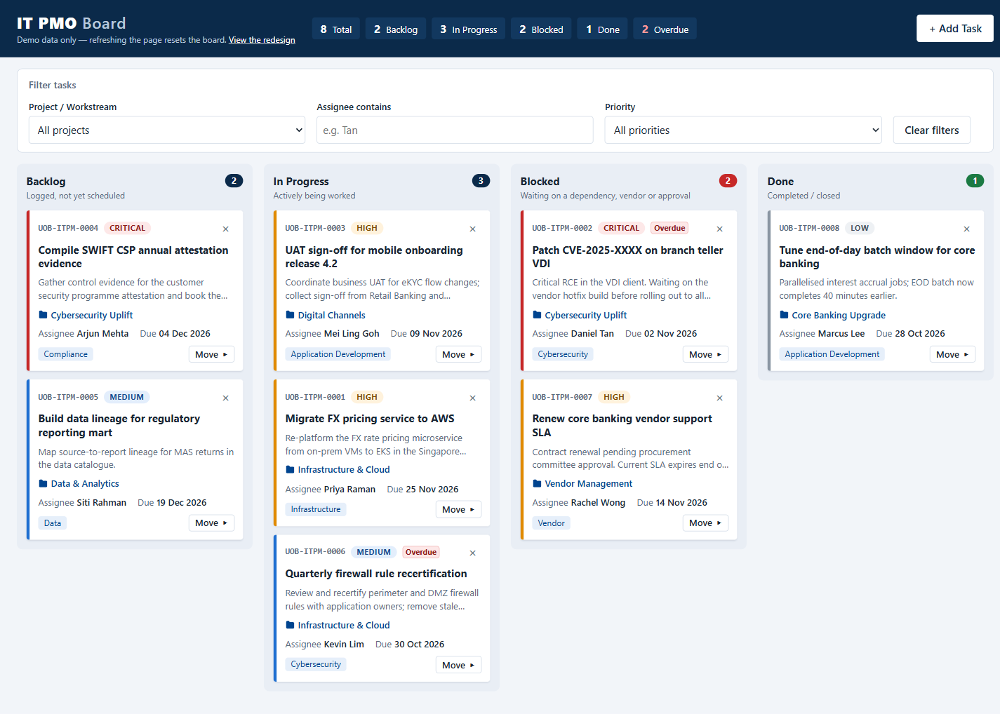
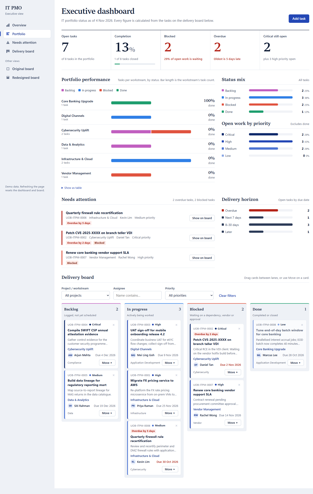
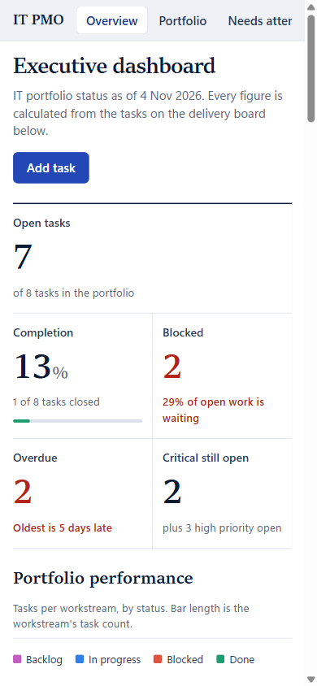

# claude_training

IT PMO demo app for a fictitious bank's IT project management office. It's built in vanilla HTML, CSS and JavaScript. Every page is a single self-contained file, with no build step and no server.

## Pages

| Page | File | Live URL |
| --- | --- | --- |
| **IT PMO Delivery Board**, the original design | `index.html` | https://study-code-2026.github.io/claude_training/ |
| **Executive KPI Dashboard**, the new page | `executive-dashboard/index.html` | https://study-code-2026.github.io/claude_training/executive-dashboard/ |
| Delivery Board redesign | `redesign.html` | https://study-code-2026.github.io/claude_training/redesign.html |

The original Delivery Board is kept unchanged as the baseline. The Executive Dashboard is a separate page, and its sidebar links back to the original board and the redesign.

## Old page and new page

| Original Delivery Board (`index.html`) | Executive KPI Dashboard (`executive-dashboard/`) |
| --- | --- |
|  |  |
|  |  |

| | Original Delivery Board | Executive KPI Dashboard |
| --- | --- | --- |
| Audience | Delivery team managing tasks day to day | CIO and IT leadership reviewing the portfolio |
| Layout | Navy header, summary chips, filter panel, then the four-column board | Left sidebar navigation, KPI strip, charts, a "needs attention" list, then the board |
| Headline numbers | Seven count chips: total, one per status, overdue | Five KPIs: open tasks, completion %, blocked, overdue (with oldest days late), critical still open |
| Charts | None | Portfolio performance (each workstream's tasks by status), status mix, open work by priority, delivery horizon (overdue, 7 days, 30 days, later) |
| Highlights | An "Overdue" badge on each card | A "Needs attention" list of overdue and blocked tasks, worst first, each with **Show on board** |
| Type and colour | System sans-serif; priority shown in red, amber, blue and grey | Serif headings and figures (Sitka or Cambria) with a sans-serif body; priority shown as a cobalt ramp, with red only for overdue and blocked |
| Task management | Add, move (drag or **Move ▸**), delete, filter | The same operations, in the "Delivery board" section, and every KPI and chart updates straight away |

The redesigned Delivery Board, the third page, is compared with the original here:

| Original (`index.html`) | Redesign (`redesign.html`) |
| --- | --- |
|  |  |

## Features (all pages)

- Four columns: Backlog, In Progress, Blocked and Done. Move cards by drag and drop or with the keyboard (**Move ▸**).
- Card colour shows priority, overdue tasks are flagged, and delete asks for confirmation inside the card.
- **Add task** opens a form with inline validation. New tasks get IDs in the form `UOB-ITPM-####`.
- Filter by project, assignee and priority.
- An email notification for each new task is sent through [FormSubmit](https://formsubmit.co).

## Running

Open any of the three HTML files in a browser. There's nothing to install.

Tasks are held only in memory, so refreshing a page resets it to the 8 demo tasks. Each page keeps its own copy, so a change on one page doesn't appear on the others. This is intentional, because the app stores no data.

## Email notifications

1. Set `FORMSUBMIT_ENDPOINT` at the top of the `<script>` in each page to your own address.
2. Add one task. FormSubmit then sends an activation email to that address. Click the link in it, and later submissions will be delivered.
