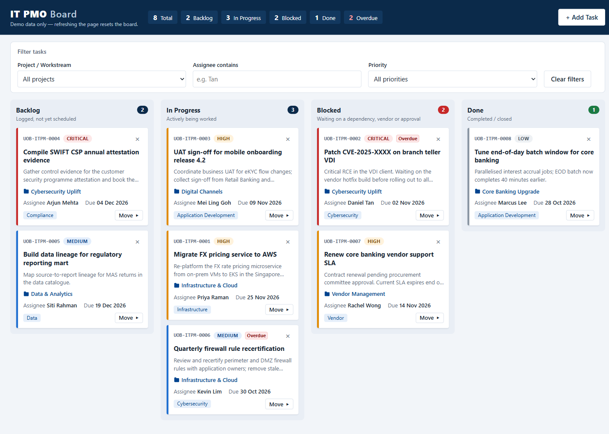
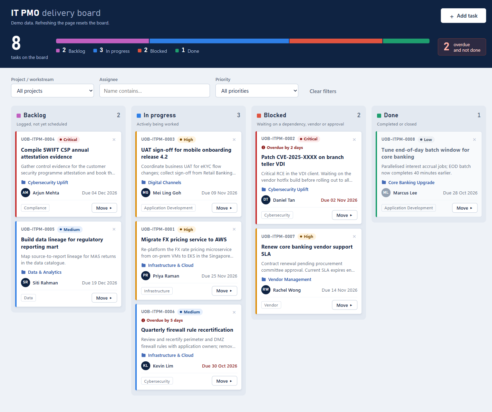
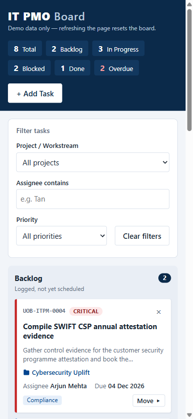
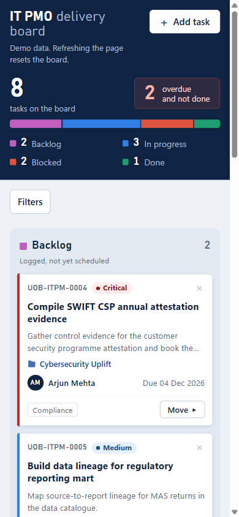

# claude_training

IT PMO Kanban board: a single-file demo and training app (vanilla HTML/CSS/JS) for a fictitious bank's IT project management office.

**Live demo**

- Original design: https://study-code-2026.github.io/claude_training/
- Redesign: https://study-code-2026.github.io/claude_training/redesign.html

Both pages have the same features. Each one links to the other from its header.

### Original and redesign

| Original (`index.html`) | Redesign (`redesign.html`) |
| --- | --- |
|  |  |
|  |  |

## Features

- Four columns: Backlog, In Progress, Blocked and Done. Move cards by drag and drop or with the keyboard (**Move ▸**).
- The left border colour shows priority, overdue tasks get a badge, and delete asks for confirmation inside the card.
- **+ Add Task** opens a form with inline validation. New tasks get IDs in the form `UOB-ITPM-####`.
- You can filter by project, assignee and priority. The header shows live totals for each status and the number of overdue tasks.
- An email notification for each new task is sent through [FormSubmit](https://formsubmit.co).

## Running

Open `index.html` (original) or `redesign.html` (redesign) in a browser. There's no build step and nothing to install, and no server is needed.

Tasks are held only in memory, so refreshing the page resets the board to its demo data. This is intentional.

## Email notifications

1. Set `FORMSUBMIT_ENDPOINT` at the top of the `<script>` in both `index.html` and `redesign.html` to your own address.
2. Add one task. FormSubmit then sends an activation email to that address. Click the link in it, and later submissions will be delivered.
